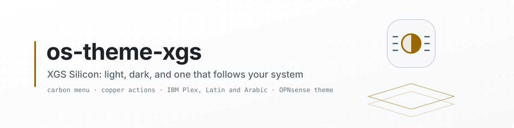
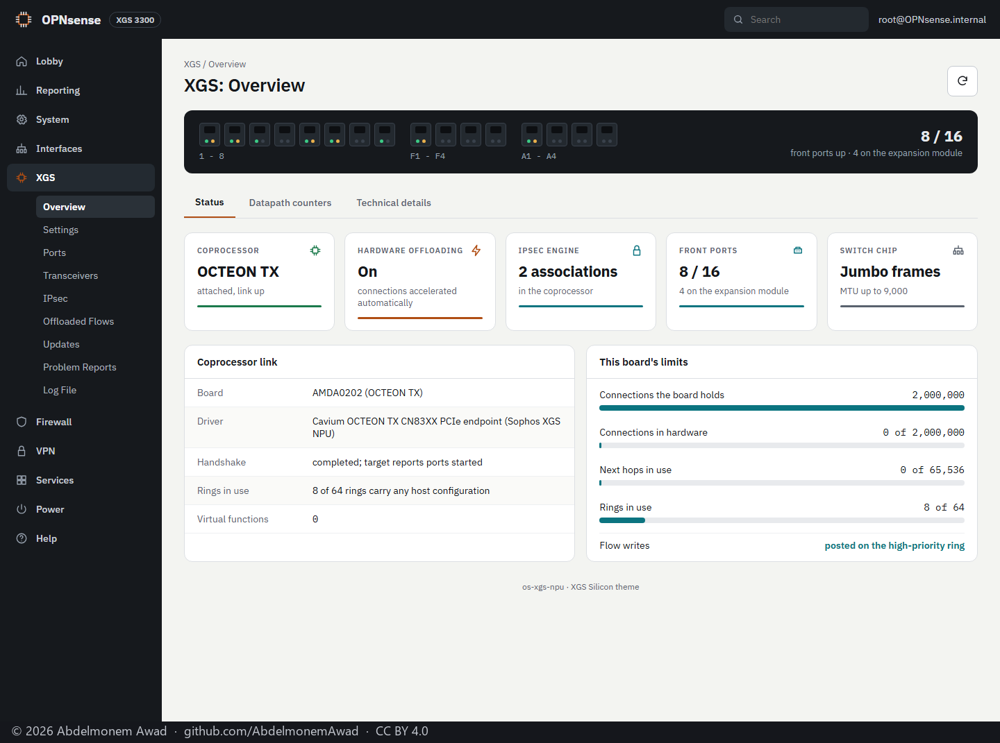
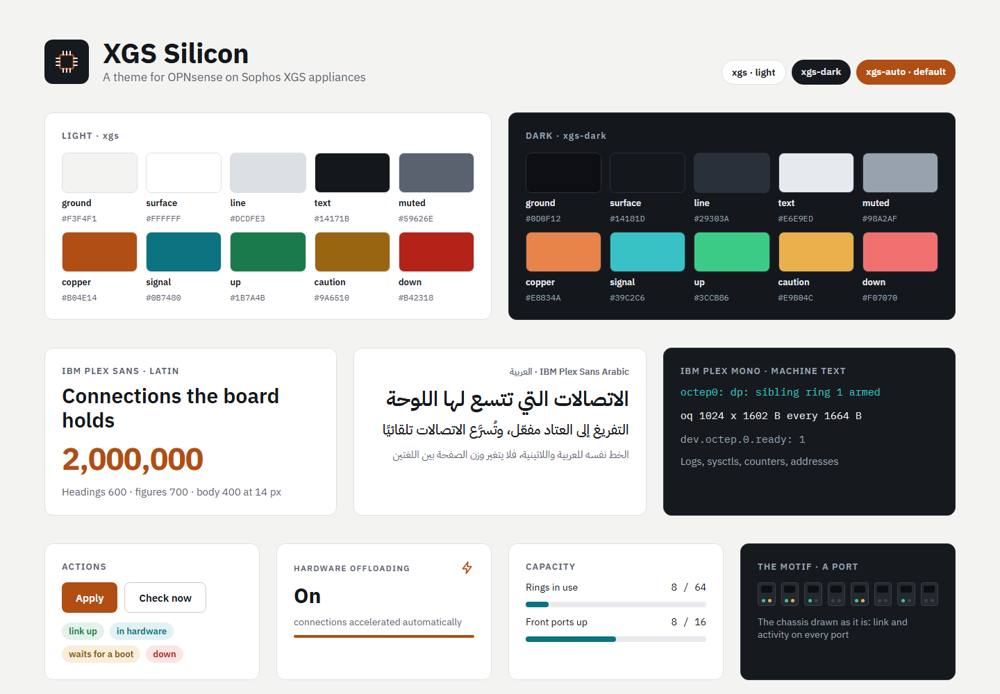
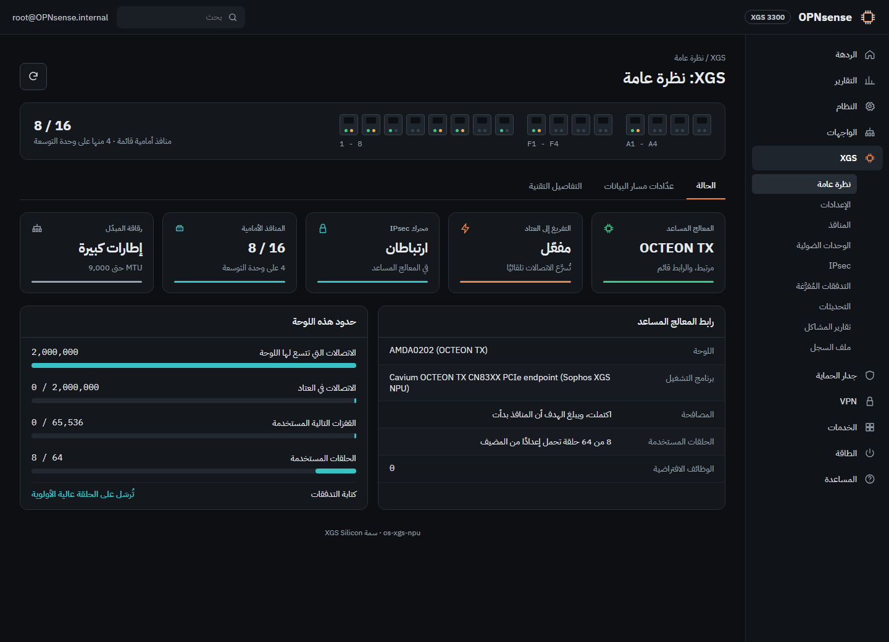
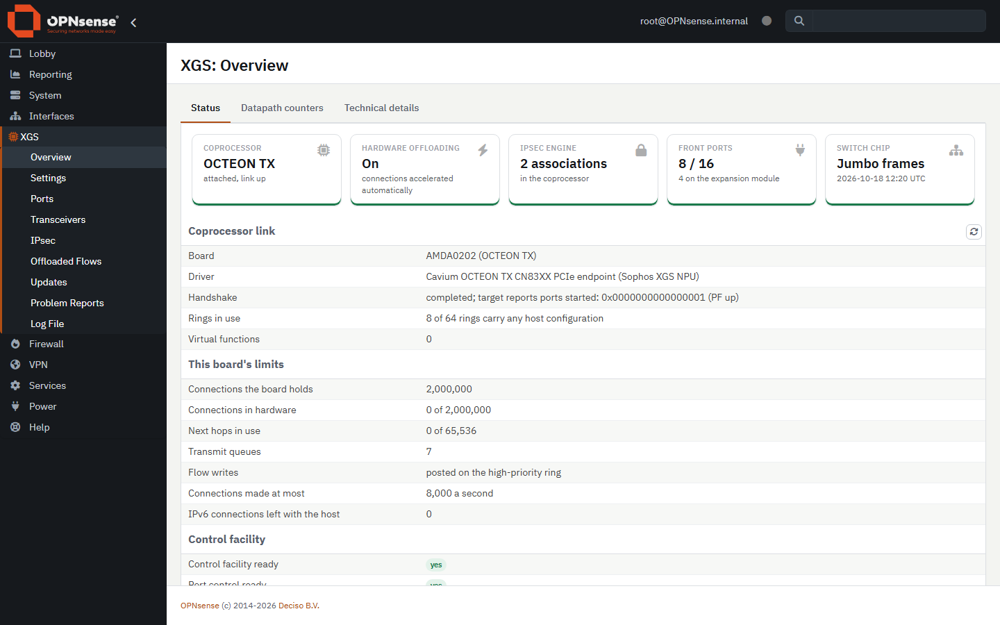
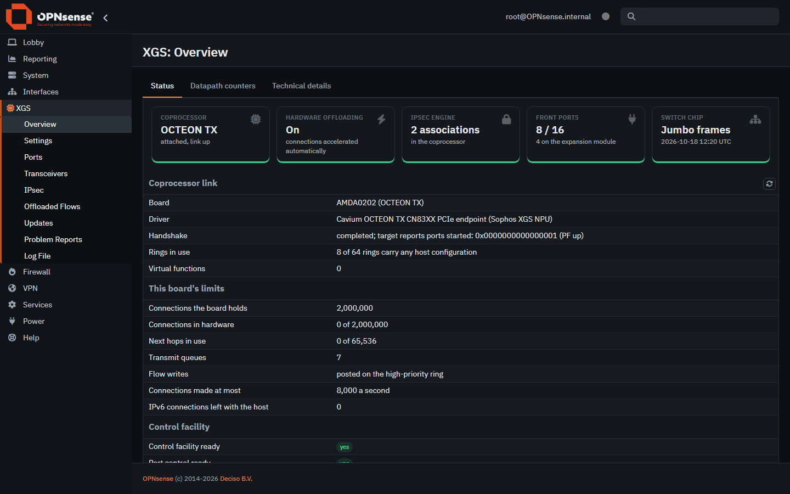
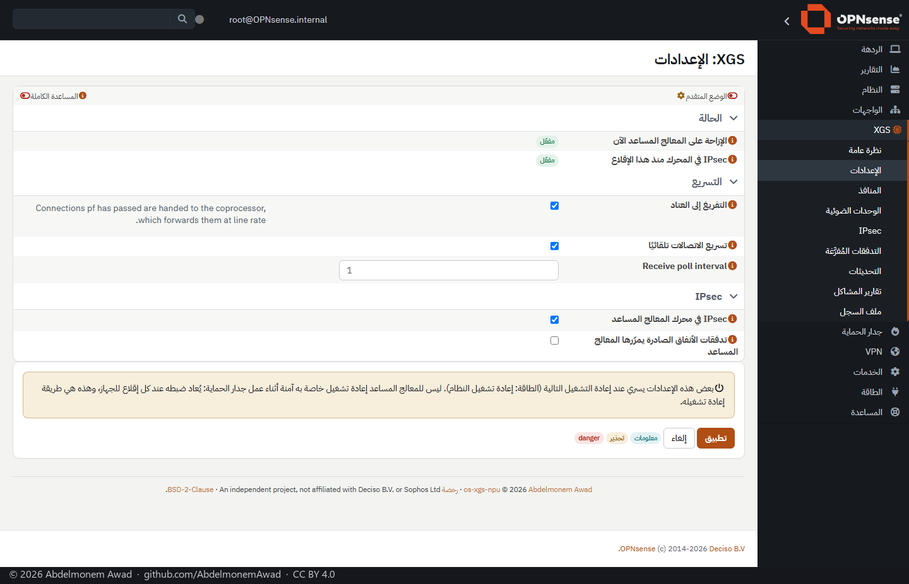
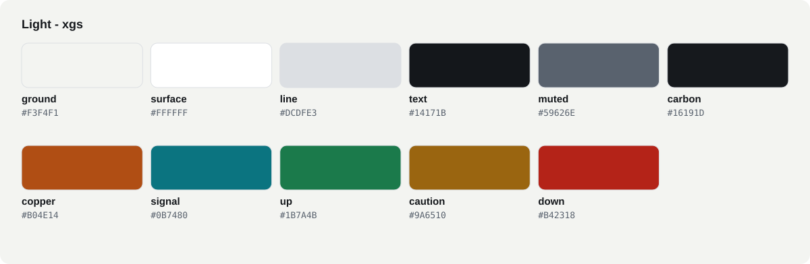
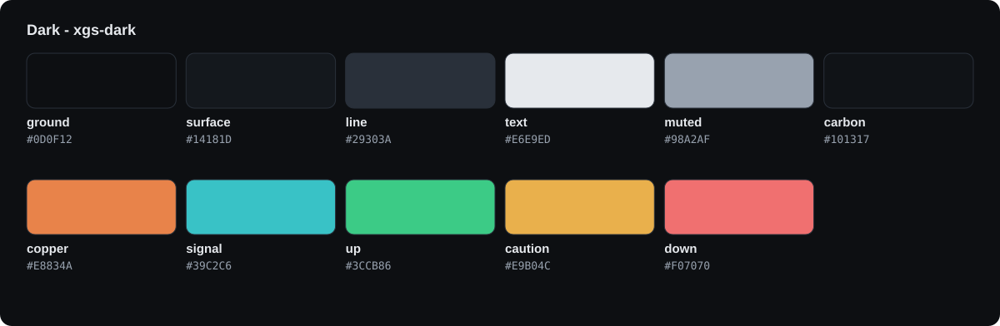

<picture>
  <source media="(prefers-color-scheme: dark)" srcset="docs/images/readme/banner-dark.svg">
  <source media="(prefers-color-scheme: light)" srcset="docs/images/readme/banner-light.svg">
  
</picture>

<p align="center">
  <a href="https://github.com/AbdelmonemAwad/os-theme-xgs/releases/latest"></a>
  <a href="https://github.com/AbdelmonemAwad/os-theme-xgs/actions/workflows/checks.yml"></a>
  <a href="LICENSE"></a>
  <a href="#installing"></a>
  <a href="#three-themes"></a>
  <a href="https://github.com/AbdelmonemAwad/os-xgs-npu"></a>
</p>

# XGS Silicon

**A theme for the OPNsense web GUI on Sophos XGS appliances: light, dark, and one that follows your
system's setting.** The bar along the top and the menu are carbon in both modes, as the chassis is;
copper marks what you act on, teal the data path. The type is IBM Plex, Latin and Arabic from one
family, carried inside the theme so that a GUI opened without internet looks the same as one with it.

It is part of the [os-xgs-npu](https://github.com/AbdelmonemAwad/os-xgs-npu) project, and an image
from [xgs-image-builder](https://github.com/AbdelmonemAwad/xgs-image-builder) starts with it.



<p align="center"><b>Contents:</b> <a href="#three-themes">Three themes</a> &middot; <a href="#the-design">The design</a> &middot; <a href="#on-real-pages">On real pages</a> &middot; <a href="#the-identity-colours">The identity colours</a> &middot; <a href="#the-type">The type</a> &middot; <a href="#what-it-changes-and-what-it-does-not">What it changes, and what it does not</a> &middot; <a href="#installing">Installing</a> &middot; <a href="#arabic">Arabic</a> &middot; <a href="#building">Building</a> &middot; <a href="#where-it-stands">Where it stands</a> &middot; <a href="#licence">Licence</a></p>

## Three themes

| Theme | What it is |
|---|---|
| `xgs` | Light: a warm grey ground, white surfaces, the carbon bar and menu. |
| `xgs-dark` | Dark: the same parts on a near-black ground, with lighter copper and teal so they read on it. |
| `xgs-auto` | Either one, as your browser's own light or dark setting says, and it switches when that setting does. **The default** in an image. |

`xgs-auto` works the way OPNsense's own `opnsense-auto` does: a small script picks the light or the
dark stylesheets before the page is drawn, and again whenever the system's setting changes.

## The design

The theme follows a design drawn first. These are its three boards: the identity, and the
coprocessor's Overview page in each mode, the dark one in Arabic and right to left.



| Light, English | Dark, Arabic, right to left |
|---|---|
|  |  |

The front-panel strip and the capacity bars in the drawings are parts of the coprocessor's pages
that the [os-xgs-npu](https://github.com/AbdelmonemAwad/os-xgs-npu) plugin is adding. The theme itself
colours what OPNsense draws.

## On real pages

The same theme on pages of the GUI, saved from an XGS 3300 running OPNsense 26.7 and drawn with the
theme's own stylesheets by `tools/serve.py`. The Arabic one was turned into Arabic with the GUI's
own translations, and laid out with the mirrored stylesheets that
[opnsense-rtl](https://github.com/AbdelmonemAwad/opnsense-rtl) makes of the theme.

| Light | Dark |
|---|---|
|  |  |



## The identity colours





| Colour | Light | Dark | What it marks |
|---|---|---|---|
| ground | `#F3F4F1` | `#0D0F12` | Behind everything. |
| surface | `#FFFFFF` | `#14181D` | Boxes, tables, cards, dialogs. |
| line | `#DCDFE3` | `#29303A` | Borders and rules. |
| text | `#14171B` | `#E6E9ED` | What you read. |
| muted | `#59626E` | `#98A2AF` | Labels, column headings, the footer. |
| carbon | `#16191D` | `#101317` | The bar along the top and the menu, in both modes. |
| copper | `#B04E14` | `#E8834A`, and `#BF5319` behind white text | What you act on: buttons, links, the active tab and menu entry. |
| signal | `#0B7480` | `#39C2C6` | The data path: progress, focus, information. |
| up | `#1B7A4B` | `#3CCB86` | Working: a link up, a check passed. |
| caution | `#9A6510` | `#E9B04C` | Look at it. |
| down | `#B42318` | `#F07070` | Broken. |

The palettes above are drawn from the token files themselves (`tools/readme-art.py`), and the checks
fail when they differ. The tokens are
[`xgs/…/_xgs-tokens.scss`](src/opnsense/www/themes/xgs/assets/stylesheets/_xgs-tokens.scss) and
[`xgs-dark/…/_xgs-tokens.scss`](src/opnsense/www/themes/xgs-dark/assets/stylesheets/_xgs-tokens.scss).
Measured: every text colour reads at 4.5:1 or better on every surface the theme puts it on: the
text, the muted text and the placeholders, the bar's and the menu's, copper and teal, the label pills,
white on every coloured button, and the text on the progress bars - near-black on the dark theme's
bright ones. The lowest are white on the dark theme's copper buttons, at
4.7:1, and the light placeholders, at 4.7:1. In the dark theme copper is two colours for that reason: white on `#E8834A` is 2.7:1.
Labels are a soft ground with their own colour as text, as the design's pills are, because white on
the dark theme's green or teal would not reach it either.

## The type

**IBM Plex Sans** for Latin, **IBM Plex Sans Arabic** for Arabic, and **IBM Plex Mono** for machine
text: logs, sysctls, counters, addresses. One stack serves both scripts, because the browser takes
each glyph from the first family that has it. The fonts are in the theme (`build/fonts`, about
660 KB), so nothing is fetched from a font service. Figures in tables line up in columns.

## What it changes, and what it does not

It changes colour, type and corners:
- the bar and the menu, including the collapsed menu's flyouts;
- tabs, which become a line under the active one;
- tables, buttons, form fields, alerts, dialogs and the login page;
- the dashboard's widgets;
- the summary cards of the appliance's own pages, where the status edge becomes a bar along the foot.

It does not change layout. The text is 14 px at a 1.35 line, which keeps OPNsense's 18 px line, so
no form or table moves. Everything else is OPNsense's own theme, unchanged.

## Installing

On the appliance, from a copy of this repository:

```sh
fetch -o /tmp/theme.tar.gz https://github.com/AbdelmonemAwad/os-theme-xgs/archive/refs/heads/main.tar.gz
tar -xzf /tmp/theme.tar.gz -C /tmp
sh /tmp/os-theme-xgs-main/install/install.sh
```

Then choose it in **System: Settings: General: Theme**, or from the shell:

```sh
sh /tmp/os-theme-xgs-main/install/enable.sh xgs-auto
```

`install/uninstall.sh` removes the three themes. If one of them is the GUI's theme, it puts OPNsense's
own back first.

The themes live in OPNsense's theme directory, where updates of OPNsense do not touch them.

## Arabic

With [opnsense-rtl](https://github.com/AbdelmonemAwad/opnsense-rtl) installed, the GUI in Arabic is
laid out right to left. That project writes a mirrored copy of every installed theme's stylesheets,
these three included, at every boot, and the installer here runs it once more so Arabic has them
straight away. In Arabic the line is taller and letter spacing is off: spacing breaks the joins
between letters.

## Building

The stylesheets in `build/css` are compiled from `assets/stylesheets`, and both are in the
repository, as OPNsense keeps its own:

```sh
npm ci
sh tools/build-css.sh
```

The theme is built on OPNsense's own `opnsense` and `opnsense-dark` themes. The base is recorded in
[`BASE`](src/opnsense/www/themes/xgs/BASE). `tools/derive-from-core.py` takes a newer OPNsense's theme
directory and derives both themes from it again, and leaves this theme's own files alone: the colour
maps, the tokens and `_xgs*.scss`. What the theme changes is in one file,
[`_xgs.scss`](src/opnsense/www/themes/xgs/assets/stylesheets/_xgs.scss).

`tools/serve.py` serves the themes as an appliance does. With saved pages of the GUI it shows them in
any of the three themes, and right to left, before anything is installed.

## Where it stands

Done, 2026-10-18:
- The light and dark stylesheets compile.
- Pages saved from an XGS 3300 running OPNsense 26.7 are drawn correctly with both themes: the
  login page, the coprocessor's Overview and Settings, and the dashboard. The Overview and Settings
  are also drawn in Arabic, right to left. Looking at them found four faults, now fixed:
  - a table heading in a serif font, because OPNsense names a font the theme does not carry;
  - the search box's icon in white;
  - the cards' status bars missing in the dark theme;
  - white text on the dark theme's bright progress bars.
- **Installed on an XGS 3300** with `install/install.sh`. Every file is served, the mirrored copies
  are made, and `xgs-auto`'s links work. `install/enable.sh xgs-auto` made the login page load
  `xgs-auto` and its switcher, and `xgs-dark` worked the same way. `install/uninstall.sh` removed the
  three themes while one was in use, and put OPNsense's theme back first. The unit's own theme was
  then restored.

Not yet: an image built with the theme and booted, and the GUI's pages beyond those four.

## Licence

BSD-2-Clause, in [LICENSE](LICENSE). The parts that come from OPNsense keep OPNsense's licence,
beside each theme directory. IBM Plex is under the SIL Open Font License 1.1, beside the fonts.
Every part that comes from elsewhere, and its terms, is listed in [THIRD-PARTY.md](THIRD-PARTY.md).

The photographs and screenshots under `docs/` are &copy; 2026 Abdelmonem Awad, under [CC BY 4.0](https://creativecommons.org/licenses/by/4.0/): use them freely, naming the author and linking here. Each carries that notice in a strip added below it.
